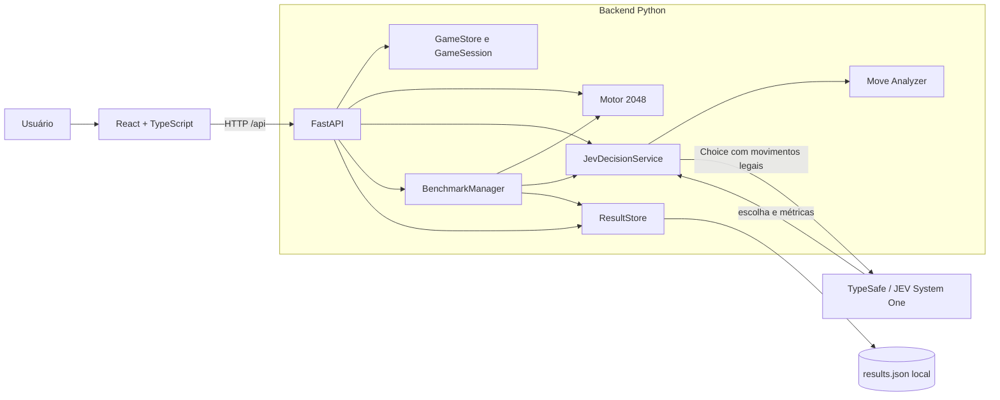

# JEV 2048 Strategy Lab

Aplicação full stack que transforma o jogo 2048 em um laboratório experimental de tomada de decisões com o **JEV System One**, da TypeSafe. O projeto combina um motor de regras determinístico, uma API FastAPI, uma interface React e ferramentas para observar e comparar duas formas de fornecer contexto ao modelo.

> O JEV escolhe as jogadas automáticas, mas não tem garantia de vencer. O 2048 exige planejamento de vários turnos e inclui geração aleatória de peças; este projeto demonstra integração, avaliação e observabilidade, não uma estratégia infalível.

## Visão geral

O usuário pode jogar manualmente com teclado, executar uma jogada do JEV por vez ou iniciar o autoplay. A interface exibe o tabuleiro, o histórico, a escolha atual e as métricas retornadas ou medidas durante a chamada. O **AI Strategy Lab** compara os modos BASIC e STRATEGIC por meio de partidas com seeds pareadas e limites configuráveis.

O backend é a fonte de verdade. Ele valida movimentos, controla concorrência, descarta respostas atrasadas e persiste resultados locais em JSON com substituição atômica do arquivo. Uma falha da TypeSafe pausa o fluxo e não é substituída por uma decisão local inventada.

## Objetivo do projeto

Este projeto foi criado para praticar e demonstrar:

- integração segura de uma aplicação com um modelo de decisão externo;
- separação entre regras determinísticas e decisões de IA;
- comparação de estratégias de contexto sob condições controladas;
- coleta de métricas sem inventar confiança ou desempenho;
- tratamento de concorrência, falhas e respostas obsoletas;
- testes automatizados de regras, contratos, persistência e benchmarks;
- comunicação técnica de limitações e resultados experimentais.

## Funcionalidades

- Jogo manual com setas ou `WASD`.
- Motor 2048 com fusões, pontuação, geração de peças, vitória e fim de jogo.
- Autoplay JEV, pausa, retomada, próxima jogada e reinício.
- Jogada forçada sem chamada à API quando existe uma única direção legal.
- Estratégias de contexto JEV BASIC e JEV STRATEGIC.
- Análise determinística das consequências imediatas de cada movimento legal.
- Exibição de probabilidades, confiança, modelo, latência, tokens e bytes quando disponíveis.
- Proteção contra respostas atrasadas após pausa, reinício ou troca de estratégia.
- Benchmarks BASIC/STRATEGIC com seeds pareadas, limites e cancelamento.
- Persistência local e exportação de resultados em JSON ou CSV.
- Histórico de partidas e agregação de métricas no Strategy Lab.

## Arquitetura



```text
apps/
├── backend/
│   ├── app/
│   │   ├── game_engine.py     # regras puras do 2048
│   │   ├── game_state.py      # estado, histórico e serialização
│   │   ├── jev_service.py     # contexto, chamada e validação do JEV
│   │   ├── move_analyzer.py   # fatos imediatos de movimentos legais
│   │   ├── benchmark.py       # experimentos BASIC/STRATEGIC
│   │   ├── result_store.py    # JSON atômico e exportações
│   │   ├── routes.py          # endpoints e controle de concorrência
│   │   └── main.py            # aplicação FastAPI e CORS local
│   └── tests/
├── frontend/
│   └── src/                   # aplicação React e componentes do laboratório
└── docs/
    ├── publication-checklist.md
    └── screenshots/README.md
```

As partidas interativas ficam em memória. Resultados, chamadas e benchmarks são gravados em `apps/backend/data/results.json`; esse arquivo é local e está ignorado pelo Git.

## Tecnologias

| Camada | Tecnologias |
| --- | --- |
| Backend | Python, FastAPI, Pydantic, Uvicorn, python-dotenv |
| IA | `typesafe-sdk` e JEV System One |
| Frontend | React, TypeScript, Vite, Lucide React |
| Testes | pytest, FastAPI TestClient e mocks/fakes locais |
| Persistência | JSON local com escrita atômica e exportação CSV |

O `package-lock.json` registra as versões resolvidas do frontend. As dependências Python usam faixas limitadas em `requirements.txt` e `requirements-dev.txt`.

## Como funciona a integração JEV

1. O backend calcula as direções legais com o motor 2048.
2. Se só houver uma direção legal, o backend a aplica como jogada forçada e não chama a TypeSafe.
3. Com mais opções, `JevDecisionService` cria um `Choice` contendo somente movimentos legais.
4. O SDK envia o estado e a pergunta ao JEV System One.
5. O backend valida se a escolha pertence às opções legais e aceita apenas métricas numéricas válidas.
6. Antes de aplicar a resposta, a API confere geração, versão do estado, estratégia e identificador da solicitação.
7. A jogada passa pelo mesmo motor usado no modo manual.

A chave é lida pelo backend a partir de `TYPESAFE_API_KEY` e não faz parte da resposta enviada ao navegador. Erros de autenticação, limite, timeout, conexão ou formato pausam o autoplay. Não existe fallback heurístico disfarçado de decisão do modelo.

## Estratégias BASIC e STRATEGIC

**JEV BASIC** recebe tabuleiro, pontuação, maior peça e movimentos legais. Esse contexto funciona como referência simples.

**JEV STRATEGIC** recebe os mesmos dados e fatos calculados para cada movimento legal antes da geração da próxima peça aleatória:

- tabuleiro resultante;
- espaços vazios;
- fusões e pontos obtidos;
- maior peça e suas posições;
- quantidade de peças;
- linhas e colunas vazias;
- presença da maior peça em um canto.

O analisador reutiliza o motor, não altera o tabuleiro original, não gera a próxima peça e não classifica alternativas. **O Python calcula consequências imediatas; o JEV continua responsável pela escolha.**

## Análise e comparação de decisões

O painel de decisão apresenta a direção escolhida, distribuição de probabilidades, confiança, latência, modelo e, no modo STRATEGIC, a tabela de consequências. A confiança representa a concentração da distribuição devolvida pelo `Choice`; ela não mede a qualidade estratégica da jogada.

Trocar de estratégia pausa a partida, incrementa a versão do estado e registra a transição. Resultados de partidas que misturam estratégias permanecem no histórico, mas não entram nas médias comparativas de BASIC e STRATEGIC.

## Benchmarks e métricas disponíveis

O Strategy Lab executa 1, 5 ou 10 partidas por modo. Cada par BASIC/STRATEGIC começa com a mesma seed, o que reproduz o tabuleiro inicial e a fonte aleatória. Depois que as estratégias escolhem movimentos diferentes, os estados e as posições de geração podem divergir.

Métricas disponíveis:

- pontuação média e máxima;
- maior peça alcançada;
- movimentos e duração média;
- latência média ponderada;
- chamadas, tokens de entrada e erros de API;
- proporção de partidas que alcançaram 2048;
- tamanho médio das requisições.

Os limites de movimentos, chamadas e duração impedem execuções sem controle. Uma falha externa registra a partida como interrompida. O projeto não inclui números de desempenho predefinidos: as tabelas mostram somente resultados produzidos localmente.

> **Atenção a custos:** iniciar um benchmark ou o autoplay pode fazer chamadas pagas. Revise os limites e use essas funções apenas com autorização consciente.

## Como executar no Windows PowerShell

Pré-requisitos:

- Python 3.12 ou mais recente;
- Node.js compatível com o Vite instalado;
- uma chave TypeSafe somente para recursos que chamam o JEV.

Na raiz do projeto, prepare o backend:

```powershell
cd apps/backend
py -3.12 -m venv .venv
.\.venv\Scripts\Activate.ps1
python -m pip install -r requirements-dev.txt
python -m uvicorn app.main:app --reload
```

Em outro terminal, prepare o frontend:

```powershell
cd apps/frontend
npm ci
npm run dev
```

Abra `http://localhost:5173`. O Vite encaminha `/api` para `http://127.0.0.1:8000`.

O modo manual funciona sem chamadas ao JEV. Os botões **Start JEV AI**, **Next Move** e **Run Comparison** podem consumir a API.

## Como configurar o `.env`

Copie o exemplo na raiz do projeto:

```powershell
Copy-Item .env.example .env
notepad .env
```

Exemplo com valor fictício:

```dotenv
TYPESAFE_API_KEY=your_typesafe_api_key_here
TYPESAFE_MODEL=jev-latest
TYPESAFE_TIMEOUT_SECONDS=20
BENCHMARK_MAX_GAMES_PER_MODE=10
BENCHMARK_MAX_MOVES=1000
BENCHMARK_MAX_CALLS=1000
BENCHMARK_MAX_SECONDS=1800
```

Substitua apenas o placeholder da chave no arquivo `.env`. Nunca inclua a credencial em commits, screenshots, issues ou logs.

## Como executar os testes

Backend, sem chamadas pagas:

```powershell
cd apps/backend
.\.venv\Scripts\Activate.ps1
python -m pytest
```

Frontend, incluindo verificação TypeScript e build Vite:

```powershell
cd apps/frontend
npm run build
```

Na revisão de 11/11/2026, a suíte concluiu **27 testes aprovados** e o build processou **2.061 módulos**. Esses valores registram apenas a validação de engenharia desta versão; não representam desempenho do JEV. Os testes de integração usam fakes e mocks e não consomem a API paga.

## Limitações conhecidas

- O JEV decide um turno por vez e não tem garantia de alcançar 2048.
- Seeds pareadas igualam o início da fonte aleatória, mas não tornam partidas divergentes idênticas.
- Partidas interativas ficam somente na memória do processo do backend.
- O arquivo JSON local é adequado à demonstração, não a múltiplas instâncias ou grande volume.
- Benchmarks reais dependem de rede, disponibilidade, limites e possíveis custos da TypeSafe.
- A interface e o CORS estão configurados para desenvolvimento local.
- Não há autenticação de usuários nem implantação de produção preparada.

## Melhorias futuras

- adicionar testes de interface para os principais fluxos do usuário;
- criar uma camada configurável de persistência para ambientes implantados;
- adicionar automação de CI para testes, build e varredura de segredos;
- avaliar mais estratégias de contexto com protocolo experimental documentado;
- apresentar intervalos e distribuição das métricas quando houver amostra suficiente;
- melhorar acessibilidade e experiência em telas menores.

Esses itens são propostas e não descrevem funcionalidades atuais.

## Screenshots

Não foram geradas imagens artificiais. As capturas reais permanecem pendentes:

| Captura | Status |
| --- | --- |
| Tela do jogo manual | Pendente |
| Autoplay JEV com dados reais | Pendente |
| AI Strategy Lab | Pendente |
| Benchmarks e resultados reais | Pendente |

Consulte o [checklist de screenshots](docs/screenshots/README.md) antes de criar e publicar as imagens.

## Segurança, licença e publicação

O `.gitignore` exclui credenciais, ambientes virtuais, dependências instaladas, builds, caches, logs, certificados e resultados locais. O `.env.example` contém somente um placeholder fictício e configurações não secretas.

Nenhuma licença foi adicionada automaticamente. A titularidade e os direitos de publicação devem ser confirmados antes de escolher uma licença. O [checklist de publicação](docs/publication-checklist.md) registra essa e outras pendências.

## Autor e contato

**Gabriel Cipolla Rocca**

- GitHub: [github.com/gcipolla1402](https://github.com/gcipolla1402)
- LinkedIn: [linkedin.com/in/gabriel-cipolla-a75605221](https://www.linkedin.com/in/gabriel-cipolla-a75605221/)

Referências técnicas: [introdução ao JEV](https://docs.typesafe.ai/introduction), [SDK Python](https://docs.typesafe.ai/sdk/python) e [primitiva Choice](https://docs.typesafe.ai/primitives/choice).
